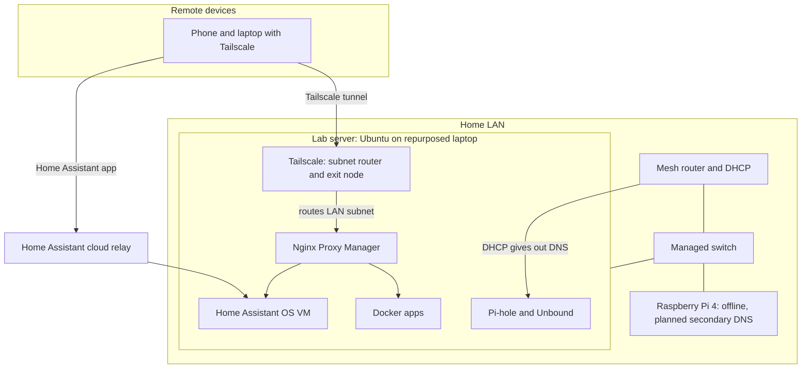

# Architecture

## Hardware

| Device | Role | Notes |
| --- | --- | --- |
| Repurposed laptop | Lab server | Ubuntu, Docker Compose, runs the Home Assistant VM |
| External media drive | Bulk storage | Separate from the system disk, holds media, photos, and file sync data |
| Raspberry Pi 4 | Planned secondary DNS node | Offline while a replacement drive ships |
| Mesh router | Gateway and DHCP | Hands out the Pi-hole as primary DNS |
| Managed switch | Wired connectivity | Available for future segmentation |

## Virtualization

Home Assistant OS runs as a single virtual machine on the lab server. The VM is managed with libvirt (`virsh`) and runs on QEMU with a bridged network interface, so it gets its own address on the LAN. Everything else runs in Docker or directly on the host.

Useful commands for checking the VM:

```
virsh list --all
virsh dominfo <vm-name>
```

## Where each service runs

Pi-hole, Unbound, and Tailscale run directly on the host. Home Assistant runs in the VM. All other services run in Docker, each defined in its own compose file.

## Service inventory

| Service | Purpose | Runs in | Access |
| --- | --- | --- | --- |
| Home Assistant | Smart home automation | VM | `.home` name on the LAN, cloud relay for remote |
| Pi-hole and Unbound | DNS filtering and recursive resolver | Host | LAN DNS for all clients |
| Nginx Proxy Manager | Reverse proxy for internal names | Docker | LAN |
| Tailscale | Remote access, subnet router, exit node | Host | Tailnet |
| Jellyfin | Media streaming | Docker | `.home` name, tailnet for remote |
| Immich | Photo library | Docker | `.home` name, tailnet for remote |
| Nextcloud | File sync and storage | Docker | Tailscale Serve (HTTPS) |
| Vaultwarden | Password manager | Docker | Tailscale Serve (HTTPS) |
| Actual Budget | Budgeting | Docker | Tailscale Serve (HTTPS) |
| Mealie | Recipes and meal planning | Docker | `.home` name |
| Uptime Kuma | Availability monitoring | Docker | `.home` name |
| Netdata | Host metrics | Docker | `.home` name |
| MySpeed | Internet speed tests | Docker | `.home` name |
| Homepage | Dashboard for the whole lab | Docker | `.home` name |

## Reserved ports on the lab server

Port conflicts have caused an outage before (see the [incident write-up](incidents/2026-10-npm-port-collision.md)), so every port in use is tracked here. Check this table before adding a service or a Tailscale Serve address.

| Port | Owner | Notes |
| --- | --- | --- |
| 22 | SSH | Host administration |
| 53 | Pi-hole | DNS for the LAN |
| 5335 | Unbound | Localhost only, upstream for Pi-hole |
| 80, 443 | Nginx Proxy Manager | Reverse proxy |
| 81 | Nginx Proxy Manager | Admin interface |
| 139, 445 | Samba | File sharing |
| 1901, 7359, 8097, 8921 | Jellyfin | DLNA, client discovery, web, HTTPS |
| 2283 | Immich | Web interface and API |
| 3000 | Homepage | Dashboard |
| 3001 | Uptime Kuma | Monitoring |
| 5216 | MySpeed | Speed tests |
| 8080 | Nextcloud | Web interface |
| 8222 | Vaultwarden | Localhost only, published through Tailscale Serve on 9443 |
| 8800 | Pi-hole | Web interface |
| 9925 | Mealie | Web interface |
| 15006 | Actual Budget | Web interface |
| 19999 | Netdata | Web interface |
| 8443 | Tailscale Serve | Actual Budget |
| 9443 | Tailscale Serve | Vaultwarden |
| 10000 | Tailscale Serve | Nextcloud |

## Diagram


