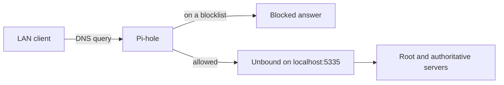

# Network and DNS

## Addressing

The lab server has a static DHCP reservation on the mesh router, so its address never changes. Examples in this repo use `192.168.x.10` for the server.

Everything shares one flat LAN, including servers, computers, and smart home devices. I tried a separate network for smart home devices before and it was never stable, so I went back to a single network. Trying again with a more careful plan is on the [roadmap](roadmap.md).

## DNS flow



1. The router hands out the Pi-hole as the primary DNS server through DHCP.
2. Pi-hole checks each query against its blocklists and client group rules.
3. Allowed queries go to Unbound on localhost, which resolves recursively instead of forwarding to a third-party resolver. See [decision 0002](decisions/0002-pihole-with-local-unbound.md).

## Secondary DNS and its trade-off

The router currently hands out a public resolver as the secondary. That keeps the network working when the Pi-hole is down, but any device that falls back to it skips filtering and local names. The plan is to bring the Raspberry Pi 4 back as a second Pi-hole, keep it in sync with Pi-hole's Teleporter export and import, and make it the secondary.

## Local names

Internal services use `.home` names. Pi-hole local DNS records point each name at the lab server, and Nginx Proxy Manager routes by hostname to the right container. This gives every service a readable name without a public domain or public certificates.

## Client groups

Pi-hole groups let different devices use different blocklists. Home Assistant can enable or disable a group on a schedule through the Pi-hole API, which allows stricter filtering for chosen devices at chosen hours.

Tailscale clients show up in Pi-hole under their tailnet addresses, not their LAN addresses. A device that is not assigned to a group by its tailnet address lands in the default group. When Tailscale clients were first pointed at Pi-hole this caused sites to fail to load. See the [incident write-up](incidents/2026-09-tailscale-clients-pihole-groups.md).

## DNS and smart home devices

Cloud-connected smart plugs and switches are sensitive to DNS behavior. Stale cached answers with a zero TTL once sent many of them into reconnect loops. See the [incident write-up](incidents/2026-10-pihole-stale-cache-smart-devices.md). After that fix, the Pi-hole cache optimizer is set to 0.

## Verifying DNS directly

When DNS looks wrong, query the server itself instead of guessing:

```
dig @192.168.x.10 example.com A +noall +answer
```

A healthy answer shows a positive TTL. This test separated a cache problem from a device problem during the smart device outage.
